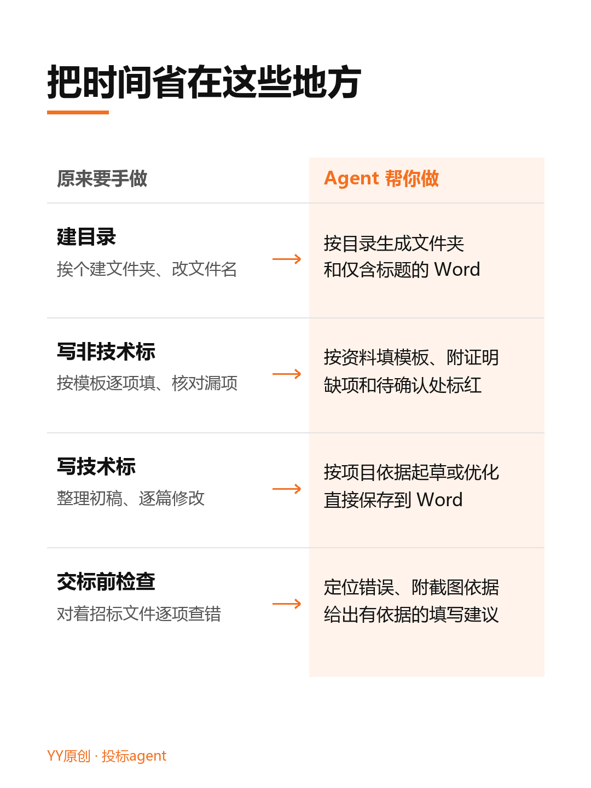
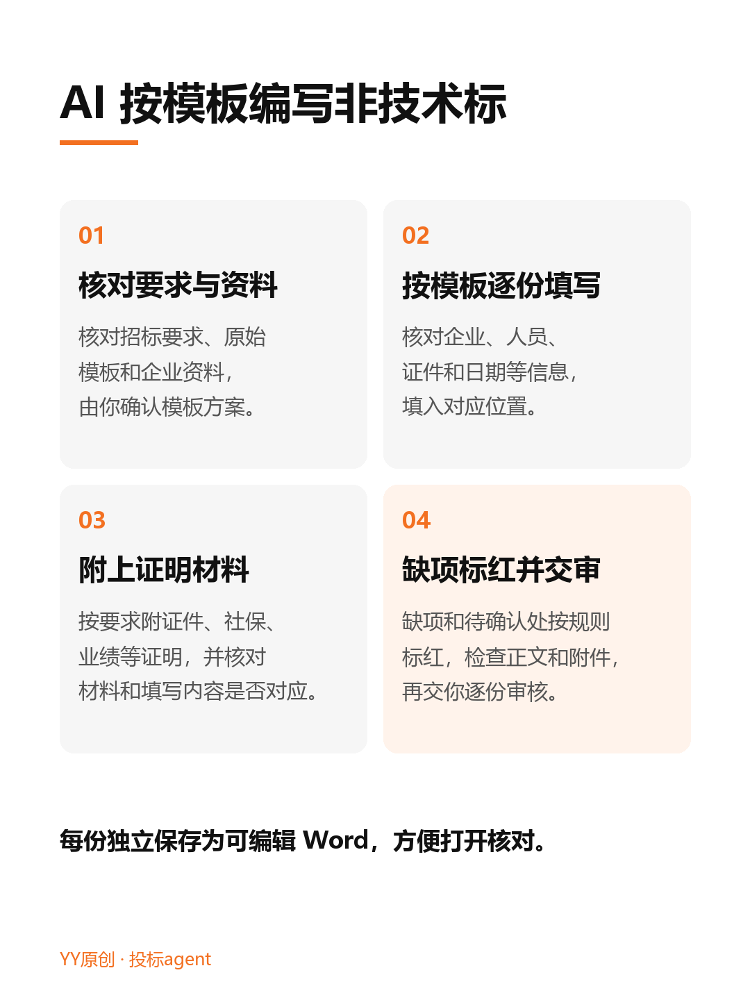
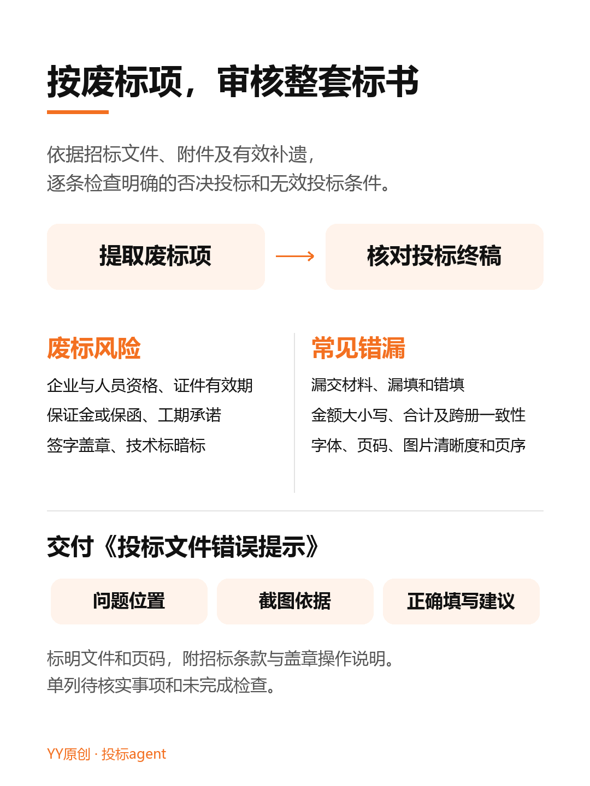
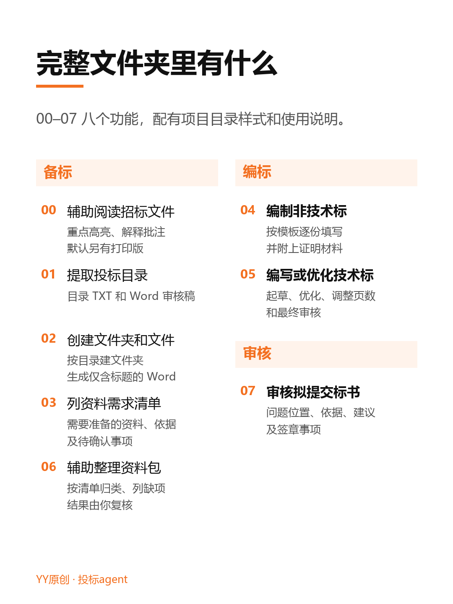

# 投标 Agent

从辅助阅读招标文件，到编写和审核整套标书。

投标 Skill 原创作者 **YY**（GitHub：`haoyue-dangkong`）。

> **免费试用版：**本仓库提供投标 Skill 第二版，包含提取目录、创建文件夹和 Word、生成资料清单、整理资料包、编制非技术标、优化技术标六项功能。
>
> **免费使用范围：**仅供个人非商业学习、研究与功能体验。未经另行授权，不得用于单位内部工作或任何商业用途。完整条款见 [LICENSE.md](LICENSE.md)。
>
> **付费完整版：**投标 Agent 包含 00—07 八项功能，覆盖备标、编标和终稿审核，提供完整工作文件夹、使用说明、使用答疑和后续更新，价格 **99 元/份**。

[免费版安装](#free-install) · [完整版功能](#agent-features) · [购买与联系](#get-agent) · [版权与使用许可](#license)

以下六张图片介绍付费完整版，点击图片可查看大图。完整版 **99 元/份**，[联系咨询与购买](#get-agent)。

<p align="center">
  <a href="assets/agent/01-cover.png"></a>
  <a href="assets/agent/02-save-time.png"></a>
</p>
<p align="center">
  <a href="assets/agent/03-technical-bid.png"></a>
  <a href="assets/agent/04-nontechnical-bid.png"></a>
</p>
<p align="center">
  <a href="assets/agent/05-final-review.png"></a>
  <a href="assets/agent/06-package-contents.png"></a>
</p>

---

<a id="versions"></a>
## 这个仓库包含什么

**本仓库公开的是六功能免费试用版 Skill。完整版投标 Agent 单独交付，下载本仓库不会获得付费完整版。**

Skill 可以理解为交给 AI 执行的任务规则包；这里的投标 Agent 是按项目组织的完整工作文件夹，包含各功能规则、使用说明和输入输出目录样式，需要在能够读写本地文件的 AI 工具中使用。

| 内容 | 免费试用版 Skill（本仓库） | 付费完整版投标 Agent |
| --- | --- | --- |
| 00 辅助阅读招标文件 | 不包含 | 标记重要原文、添加解释批注，默认另有打印版 |
| 01 提取目录、02 创建文件 | 提取目录，按审核后的 TXT 创建文件夹和标题 Word | 按功能分别准备资料、交付目录与实体文件，并提供操作和交接说明 |
| 03 资料清单、06 整理资料包 | 列资料需求，经审核后整理项目资料包 | 按项目核对并分类资料，交付《缺失资料清单》，整理结果由用户复核 |
| 04 非技术标 | 核验资料与模板，逐份编制并交审 | 确认模板和填写方案，逐份填写、附证明材料，缺项标红并交审 |
| 05 技术标 | 以已有技术标为输入，进行格式化、逐篇优化和总页数调整 | 支持已有正文或空白 Word，按四步完成格式化或起草、内容优化、页数调整、最终审核 |
| 07 整套终稿审核 | 不包含 | 对照招标依据检查指定终稿，交付含位置、依据、截图和整改建议的问题报告 |
| 获取方式 | 免费下载并安装，仅供个人非商业学习、研究与功能体验 | 99 元，网盘交付完整 Agent 文件夹，包含使用答疑和后续更新 |

---

<a id="agent-features"></a>

## 付费完整版

### 为什么做这个工具

投标工作包含大量重复操作，也需要反复核对细节：招标要求分散在正文和附件里，目录需要逐个建立，企业和人员资料需要对应到表格，复制填写时容易漏项，临近开标还要检查金额、工期、签章和最终页面。

投标 Agent 从投标专员的实际工作需求出发，把这些操作整理为可分步执行、可查看成果、可人工审核的流程。重点是减少重复劳动，帮助发现遗漏和前后不一致，让需要补资料、确认或修改的位置更容易找到。

它主要面向需要亲自准备、编写和检查标书的投标专员。

### 相比免费版增加了什么

免费版已经具备六项编标辅助功能，可以先体验目录、资料和文档处理流程。完整版进一步补充辅助阅读、技术标起草与最终审核、整套终稿审核，并提供对应的项目组织方式和操作说明。

### 完整交付清单

| 交付内容 | 具体包括 |
| --- | --- |
| 完整 Agent 工作文件夹 | 00—07 八项功能及其执行规则 |
| 功能与使用说明 | 每项功能如何准备资料、发送指令、审核及查看成果 |
| 项目目录样式 | 输入、输出及项目资料的组织示例 |
| 使用前准备 | Codex、WorkBuddy 两种使用方式的准备说明 |
| 使用答疑 | 使用过程中遇到问题可联系咨询 |
| 后续更新 | 产品后续版本更新 |

### 八项功能分别做什么

#### 00 辅助阅读招标文件

**处理对象：**招标文件及本项目适用的附件、答疑、澄清等资料。

阅读正文、表格和附件，标记编标、投标时重要且容易遗漏或误读的原文；在需要解释的位置批注“为什么重要、需要做什么”。处理后核对原文、批注位置和实际页面，再交用户审阅。

**交付成果：**带重点标记和解释批注的招标文件副本，默认另有便于查看重点与解释的打印版。

#### 01 提取投标文件目录

**处理对象：**本次招标文件和附件。

查找投标文件组成和格式要求，梳理各项材料及附件归属，整理名称、层级、顺序和编号。可以先预览，再按要求保存并交用户审核。

**交付成果：**目录 TXT、Word 审核稿及对应版本说明。这里的“目录”是结构清单，实际文件夹由 02 创建。

完整版当前 01 的读取范围不含另行提供的答疑、澄清和补遗；这些文件如影响目录，应另行核对，不能视为 01 已经处理。

#### 02 按目录创建文件夹和 Word

**处理对象：**一份已确认的目录 TXT。

识别文件夹和 Word 的上下级关系，按目录创建文件；完成后核对数量、层级、名称和标题格式。

**交付成果：**实际文件夹，以及每份只包含标题的 Word 文件，减少逐个新建和改名的重复操作。

**标题 Word 用来搭建文件结构，不能代替招标附件中的原始表格模板。**

#### 03 生成资料需求清单

**处理对象：**PDF 或 Word 招标文件，以及已收到的适用附件、补充文件。

提取需要准备的资料，区分企业证明材料、需要确认的事实和可以按模板编制的文件；合并重复需求和同一人员的资料，保留“若有”等条件与来源依据。

**交付成果：**Word 资料需求清单，说明需要什么、依据在哪里、哪些事项还要确认。清单先交用户审核，再供资料准备使用。

#### 04 逐份编制非技术标

**处理对象：**招标依据、投标目录或已有文件结构、投标人资料包，以及招标正文或附件中的原始格式。

先确认招标要求、模板、资料和填写方案，再在模板副本中填写企业、人员、证件、日期等已确认信息，附上对应证明材料。编制时按项目依据核对证件有效期，并检查文字、附件和实际页面。

需要补充、填写或确认的位置按规则标红。**每完成一份独立文件就交用户审核，当前文件通过后再处理下一份。**

**交付成果：**按模板填写、附有证明材料的独立非技术标 Word 文件，以及需要继续处理的事项。

#### 05 分四步编写或优化技术标

**处理对象：**空白或已有正文的技术标 Word，以及招标文件、工程量清单等项目依据。支持按项目要求核对单篇和总页数。

| 步骤 | 处理内容 | 审核方式 |
| --- | --- | --- |
| 1. 格式化或起草 | 确认篇目、标题、编号和格式；已有正文整理格式，空白 Word 依据项目资料列纲起草 | 已有正文先看代表格式稿；空白稿将大纲与初稿一并交审 |
| 2. 内容优化 | 逐篇去重、理顺表达，保留必要事实、数字和承诺，完善有依据的响应内容 | 一次交付一篇，当前篇审核通过后再处理下一篇 |
| 3. 页数调整 | 保持已确认格式，有依据地扩展或精简内容，核对单篇和总页数 | 授权完整流程时，自查完成后进入第四步 |
| 4. 最终审核 | 检查篇目、文章标题、层级编号、标点、格式和实际页面，修改后复核页数 | 提交最终审核稿与未解决事项，由用户确认 |

**交付成果：**按篇保存的可编辑 Word、各阶段成果和检查记录。可以指定只做某一阶段，也可以按审核节点完成四步。

作者提供的个人测试范围为单篇约 50—60 页、整套约 500—600 页、合计约 25 万字，采用分步处理。该规模是个人测试案例；具体项目仍需结合资料、工具环境和实际输出逐份检查。

05 的最终审核侧重技术标本身，完成后不会自动启动 07 的整套投标终稿审核。

#### 06 按清单辅助整理资料包

**处理对象：**已确认的资料需求清单、指定范围内的公司资料，以及核对需要的招标依据。

按清单核对企业、人员、用途和期限，整理符合要求的原始资料副本，并把缺失、过期、不匹配或需要确认的事项列出来。

**交付成果：**按“企业资质、项目人员、企业业绩”分类的资料文件夹，以及《缺失资料清单.docx》。原始公司资料保留，整理结果由用户复核。

#### 07 审核拟提交的整套标书

**处理对象：**招标文件及适用附件、实际准备提交的投标文件（Word、PDF 等指定格式），以及编制时使用的资料包。也可以指定只审核某个分册。

先确认审核范围、文件版本和方案，再从招标依据盘点应交要求，逐项核对指定终稿。检查内容包括资料完整性、资格与证件、工期和其他承诺、报价及大小写、保证金或保函、签字盖章要求，以及格式、图片和页面。

**交付成果：**《投标文件错误提示》Word 报告，包含问题位置、依据、原页截图、整改建议、签章事项，以及待核实和未完成检查的范围。整改后可以继续按问题复核。

报告帮助定位问题和安排修改。07 本身不自动改写标书，05、07 的检查结果也不能替代用户对最终提交版本的审核。

<a id="get-agent"></a>
### 购买与联系

**价格：99 元/份。网盘交付，包含使用答疑和后续更新。**

需要购买完整版，或想先了解是否适合当前的投标工作，可以通过下方渠道联系咨询。详细使用教程随完整版交付。

单位使用、商业用途及其他授权需求，请通过下方渠道联系作者，另行确认授权范围。

- 小红书：搜索 `yy（ai编标版）`，在置顶链接下单。
- 微信：`yyonlinegame`，备注“投标v3”。

---

<a id="free-install"></a>
## 免费版怎么安装

**安装前请先阅读 [LICENSE.md](LICENSE.md)：免费试用版仅供个人非商业学习、研究与功能体验，不授权单位内部使用或任何商业使用。** 如需超出该范围使用，请先[联系作者](#get-agent)取得明确的书面授权。

免费版安装的是本仓库中的 `bid-workflow-skill`。它与完整版工作文件夹的启动方式不同，**不包含 00 和 07**。

### 方法一：让 Codex 安装

在 Codex 中发送：

```text
使用 $skill-installer 从
https://github.com/haoyue-dangkong/bid-workflow-skill2
安装这个 Skill。
```

安装后确认 `bid-workflow-skill` 已被识别。如果没有显示，可以重启 Codex 后再次检查。

### 方法二：Windows 手动安装

已安装 Git 的用户，可以在 PowerShell 中执行以下命令。Git 是用于下载和管理代码仓库的工具；这组命令只用于首次安装到不存在的目标文件夹。

```powershell
New-Item -ItemType Directory -Force "$HOME\.agents\skills" | Out-Null
git clone https://github.com/haoyue-dangkong/bid-workflow-skill2.git "$HOME\.agents\skills\bid-workflow-skill"
```

目标文件夹已存在时不要重复克隆。已有安装且未自行修改内容的，可以在该文件夹中更新：

```powershell
Set-Location "$HOME\.agents\skills\bid-workflow-skill"
git pull
```

Codex 的本地 Skill 目录、安装和识别方式见 [OpenAI 官方 Skill 文档](https://learn.chatgpt.com/docs/build-skills)。

---

<a id="free-usage"></a>

## 免费版怎么用

以下示例用于个人非商业学习与体验，可使用模拟资料测试。不得将免费试用版用于单位工作任务、本人经营活动或向客户提供服务，除非已另行取得授权。

仓库名是 `bid-workflow-skill2`，内部 Skill 名称是 `bid-workflow-skill`。下面的 `$bid-workflow-skill` 用于明确指定这个 Skill；客户端也可以根据任务描述匹配已安装的 Skill。

### 提取投标文件目录

```text
使用 $bid-workflow-skill 的功能1，从这份招标文件中提取投标文件目录。
```

### 按目录创建文件

```text
使用 $bid-workflow-skill 的功能2，解析这个目录TXT。
先输出完整预览，等我针对当前预览回复“审核通过”后再创建文件。
```

### 生成资料需求清单

```text
使用 $bid-workflow-skill 的功能3，生成资料需求清单，
保留招标依据和限制条件，同一个人的资料合并到一条。
```

### 整理项目资料包

```text
使用 $bid-workflow-skill 的功能6，根据已确认的资料清单扫描企业资料。
先给我候选匹配和预计复制清单，审核通过后再整理资料包。
```

### 编制非技术标

```text
使用 $bid-workflow-skill 的功能4，先核对项目资料包和模板。
资料核对结果审核通过后，逐份编制非技术标，每完成一份交我审核。
```

### 优化技术标

```text
使用 $bid-workflow-skill 的功能5，先统一已有技术标Word的格式，
再逐篇优化，审核通过后按要求调整总页数。
```

免费版的详细执行规则见仓库中的 [SKILL.md](https://github.com/haoyue-dangkong/bid-workflow-skill2/blob/main/SKILL.md) 及其引用文件。处理 PDF、图片、Word 和页数还需要相应的读取、文字识别、文档编辑及排版检查能力，只有文本对话能力的环境不能完成全部文件操作。

<details>
<summary>功能 2 辅助脚本</summary>

三个 Python 辅助脚本用于解析目录、创建结构和核对结果。在仓库根目录运行，替换示例中的输入文件和输出目录：

```powershell
# 解析目录并显示预览
python scripts\parse_bid_tree.py 目录.txt

# 只预览，不创建文件
python scripts\create_bid_structure.py 目录.txt 输出目录

# 用户已针对当前预览明确审核通过后，才使用 --approved
python scripts\create_bid_structure.py 目录.txt 输出目录 --approved

# 核对目录结构、Word及标题
python scripts\check_bid_structure.py 目录.txt 输出目录
```

`--approved` 是脚本的执行开关，不能代替用户对当前目录预览的审核。

</details>

---

<a id="repo-structure"></a>

## 仓库目录结构

```text
bid-workflow-skill2/
├─ README.md
├─ LICENSE.md          个人非商业使用许可
├─ SKILL.md
├─ agents/
│  └─ openai.yaml
├─ references/          六项功能的详细规则
├─ scripts/            功能2辅助脚本
└─ assets/agent/       完整版介绍图片
```

---

## 使用边界

- 招标文件及适用的正式补充文件是要求来源，企业原始资料和已确认信息是事实来源。来源冲突时分别列明，不自行猜选。
- 保留输入原件，在副本和独立输出位置处理；缺少数据、待确认事项和未完成检查应明确报告。
- 每次使用针对指定文件、版本和范围开展。成果生成、程序检查通过、用户审核通过是不同状态。
- AI 辅助编制和审核不能保证不废标。报价决策、资料真实性、签字盖章和最终提交仍需相关人员核实办理。

---

<a id="license"></a>

## 版权与使用许可

Copyright © 2026 YY（GitHub：`haoyue-dangkong`）。除明确许可及法律、平台条款规定的情形外，保留其他权利。

本仓库免费试用版采用[《投标 Skill 个人非商业使用许可》](LICENSE.md)，仅供个人非商业学习、研究与功能体验。允许在该范围内下载、安装、运行、备份及进行必要修改，并让 AI 工具读取和执行规则。

未经作者另行明确书面授权，不得用于单位内部工作、本人经营活动、收费代编标或其他商业用途；不得对外分发、转售、重新授权或打包出售规则、脚本、文档及其修改版，不得删除版权和许可声明。法律规定、GitHub 平台条款允许或作者另行授权的情形除外。

本许可不把用户输入资料和生成成果一概归为作者所有，也不主张独占投标方法或功能思想。付费完整版不适用本免费许可，具体权限以另行提供的授权条款为准。单位使用、商业用途及其他授权需求，请见[购买与联系](#get-agent)。

---

## 反馈与联系

免费版问题可在本仓库反馈。提交反馈前请对企业资料、个人证件和招投标文件进行脱敏。付费完整版咨询与答疑请见[购买与联系](#get-agent)。
